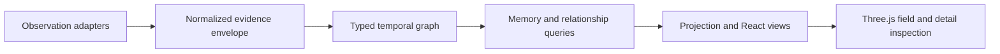

# Multichain Data Observatory

**Traceable multichain observations, temporal relationships and interactive 3D context.**

   

[Overview](#overview) · [Quickstart](#quickstart) · [Example](#example) · [Validation](#validation) · [Documentation](#documentation)

## Overview

An interactive observatory for exploring market and social observations across networks. React views and a Three.js field retain the identity, timestamps and evidence behind each observation. Temporal graph modules model relationships independently of their 3D projection.

**Stack:** TypeScript · JavaScript · React · Three.js · Vite · Node.js

## What the field represents

| Component | Behavior |
| --- | --- |
| Typed graph | Token, observation, source, social-profile and narrative nodes have explicit relationship types. |
| Evidence envelope | Capture IDs, hashes, receive times and source paths remain attached to graph records. |
| Temporal memory | Activation is updated by observed events and decays with elapsed time. |
| Projection | Graph identity is separate from spatial layout and visual motion. |
| Context reads | Typed read contracts associate interpretations with bounded evidence references. |

## Processing path



## Quickstart

```console
npm ci --ignore-scripts
npm run typecheck
npm run build:viewer
```

Use a Node.js runtime compatible with the lockfile and Vite version. These are the available type/viewer-build paths; their success must be checked in your environment. npm run dev serves the viewer on http://127.0.0.1:4317. Source-specific services and omitted media require separate setup. The default build/test helpers are absent; see Configuration and storage.

## Example

**Read an observation through its evidence**

1. Select a token or observation in the field.
2. Inspect its chain identity, source context and capture time.
3. Follow relationships to the supporting source or social profile.
4. Keep graph evidence separate from an interpretation or a preview activity label.

The [domain types](src/jev-neural/domain.ts) define the graph vocabulary. [Temporal memory](src/jev-neural/temporal-memory.ts) and [projection](src/jev-neural/projection.ts) implement distinct processing stages. This walkthrough describes the interaction model, not a recorded live session.

## Configuration and storage

`DATA_STREAM_UPSTREAM` and `NEWS_STREAM_UPSTREAM` select upstream data services; `JEV_GATEWAY_KEY` is a local secret. See [.env.example](.env.example). The default build script references a private-preview helper absent from this snapshot; use the separately declared `build:viewer` path to build the Vite viewer. The declared test command also references scripts absent from this snapshot; this is an explicit validation blocker.

## Repository guide

| Location | Responsibility |
| --- | --- |
| [src/jev-neural/domain.ts](src/jev-neural/domain.ts) | Typed graph and evidence vocabulary |
| [src/jev-neural/graph.ts](src/jev-neural/graph.ts) | Graph ingestion and traversal |
| [src/jev-neural/temporal-memory.ts](src/jev-neural/temporal-memory.ts) | Temporal activation and decay |
| [src/jev-neural/projection.ts](src/jev-neural/projection.ts) | 3D projection |
| [src/agent-trading/AgentTradingJev.tsx](src/agent-trading/AgentTradingJev.tsx) | Application view |

## Validation

The quickstart lists the declared checks. No passing CI or coverage claim is implied by the technology badges.

## Scope and operational boundaries

The browser is a presentation boundary; a rendered field does not establish source availability or complete backend ingestion. Preview activity is illustrative and is documented separately from live observations. Some media are absent. The root MIT license and proprietary/confidential source notices are inconsistent; reconcile their intended scope before relying on a uniform reuse grant. Existing copyright and notices are preserved.

## Documentation

- [Architecture and boundaries](docs/ARCHITECTURE.md)
- [Data contract](docs/DATA-CONTRACT.md)
- [Temporal graph design](docs/JEV-NEURAL-GRAPH.md)
- [Illustrative preview activity](docs/CONFIDENTIAL_PREVIEW.md)
- [Trust boundaries](docs/SECURITY.md)

## License and attribution

Project-authored source code is licensed under the [MIT License](LICENSE). Third-party components and datasets retain their respective rights and licenses.
