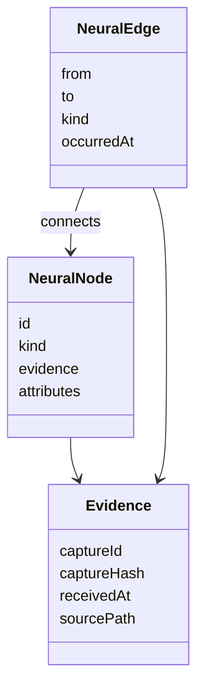

# Multichain Data Observatory

   

Explore market and social observations as a typed temporal graph, then project that graph into an interactive React/Three.js field.

The spatial view is one representation of the data. Source identity, evidence references and temporal relationships live in the domain model independently of where a node appears on screen.

## What is actually in the graph

[domain.ts](src/jev-neural/domain.ts) defines five node kinds: `token`, `observation`, `source`, `social_profile` and `narrative`. Edges distinguish capture, mention, link, share and membership relationships. Evidence records carry a capture ID/hash, receive time and source path.



[graph.ts](src/jev-neural/graph.ts) owns ingestion/traversal; [temporal-memory.ts](src/jev-neural/temporal-memory.ts) handles activation/decay; [projection.ts](src/jev-neural/projection.ts) supplies spatial representation. Typed interpretations retain `observe`, `review` or `insufficient` status and evidence IDs.

## Build the available viewer path

```console
npm ci --ignore-scripts
npm run typecheck
npm run build:viewer
```

These are declared paths, not a claim that this snapshot passes them. `npm run dev` serves the viewer at `http://127.0.0.1:4317`. `DATA_STREAM_UPSTREAM`, `NEWS_STREAM_UPSTREAM` and the local `JEV_GATEWAY_KEY` configure external source access; see [.env.example](.env.example).

## Snapshot limitations to resolve

- Default build and test commands reference helper scripts absent from this checkout. The separate viewer build does not repair those missing scripts.
- Some media and source-specific services are not distributed here. Preview activity is illustrative, not proof of a live source connection.
- The root MIT file and retained proprietary/confidential source headers have conflicting scope. Review the actual source notices before reuse; this README does not resolve those rights.

Because of these gaps, the visual architecture is described from source rather than presented as a validated complete deployment.

**Technology:** TypeScript · JavaScript · React · Three.js · Vite · Node.js

See [LICENSE](LICENSE) and the conflicting source notices described above before reuse.
